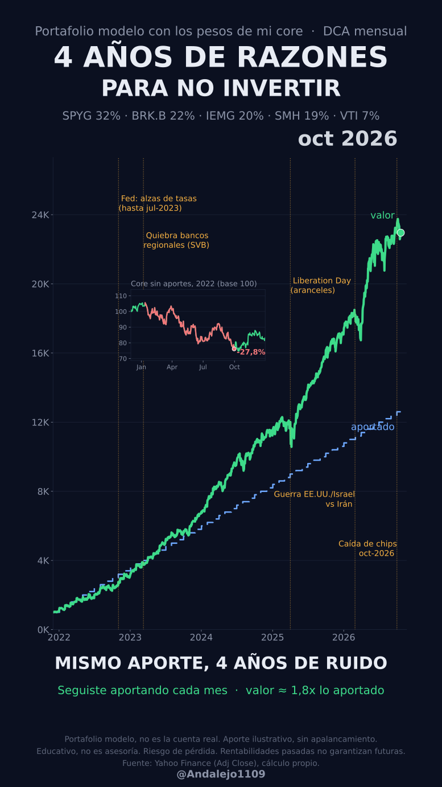

# 4 años de ruido: DCA en el core (dic-2021 → oct-2026)

> **¿Qué habría pasado si, en medio de alzas de la Fed, quiebras de bancos, aranceles y guerra, hubieras seguido aportando lo mismo cada mes a un portafolio diversificado y sin apalancamiento?**



Animación completa: `output/reel_4anos.gif` (se genera al correr el script).

> ⚠️ **Aviso educativo.** Este repositorio es educativo y no es asesoría de inversión. Invertir tiene riesgo de pérdida. Las rentabilidades pasadas no garantizan resultados futuros. Es un **portafolio modelo** con los pesos del core: **no es la cuenta real** de eToro.

## Pesos del core (portafolio modelo)

| Activo | Peso |
|---|---:|
| SPYG | 32% |
| BRK.B | 22% |
| IEMG | 20% |
| SMH | 19% |
| VTI | 7% |

Sin apalancamiento. Rebalanceo mensual a los pesos objetivo.

## Hallazgo

Aporte ilustrativo: capital inicial US$1.000 + US$200 al mes (parámetros `CAPITAL_INICIAL` y `APORTE_MENSUAL` al inicio del script).

| Métrica | Valor |
|---|---:|
| Total aportado (dic-2021 → 21-oct-2026) | US$12.600 |
| Valor de mercado al 21-oct-2026 | US$22.957 |
| Múltiplo valor / aportado | 1,82x |
| Caída máxima 2022 del core comprado y mantenido (sin aportes) | −27,8% (12-ene-2022 → 30-sep-2022) |

El mismo aporte cada mes, sin vender en la caída de 2022, es lo que explica el resultado. No se trata de adivinar el momento.

### Eventos marcados en el gráfico

| Evento | Fecha |
|---|---|
| Fed: ciclo de alzas de tasas (marcado en el alza del 2-nov-2022; ciclo hasta jul-2023) | 2022-11-02 |
| Quiebra de bancos regionales (SVB) | 2023-03-10 |
| Liberation Day (aranceles) | 2025-04-02 |
| Guerra EE.UU./Israel vs Irán | 2026-02-28 |
| Caída de chips | oct-2026 (marcado el 2026-10-01, fecha aproximada) |

`cifras.csv` incluye además la caída de pico a valle alrededor de cada evento (índice sin aportes; pico de los 28 días previos → mínimo de los 90 días siguientes).

## Metodología

- **Datos:** Yahoo Finance, precios de cierre ajustados (*Adj Close*, incluye dividendos) vía `yfinance`, diarios desde oct-2021, con caché local en `data/precios.parquet`.
- **Índice del core:** al inicio de cada mes los pesos vuelven al objetivo; dentro del mes cada activo deriva con su precio.
- **DCA:** capital inicial el primer día hábil de dic-2021 y luego un aporte fijo el primer día hábil de cada mes, comprando "unidades" del índice.
- **Caída 2022:** pico a valle del índice del core entre dic-2021 y sep-2022.
- **Animación:** matplotlib, 1080×1920 (9:16), 12 s a 20 fps; el GIF se arma con ffmpeg (paleta).

## Sesgos y limitaciones

- **Sesgo de retrospectiva:** los pesos del core se eligieron hoy y se aplican hacia atrás.
- **Sin costos:** no incluye comisiones, spread, conversión de moneda, impuestos ni retención de dividendos.
- **Muestra corta:** son menos de 5 años, con un mercado alcista dominante después de 2022.
- **Elección del inicio:** cambiar la fecha de inicio cambia el resultado.
- **Fechas de eventos aproximadas:** la caída de chips de oct-2026 tiene fecha aproximada.
- **No es la cuenta real:** tus aportes, fechas y pesos reales difieren.

## Cómo correr

```bash
git clone https://github.com/Andalejo1109/4-anos-de-ruido-dca
cd 4-anos-de-ruido-dca
python -m venv .venv && source .venv/bin/activate   # Windows: .venv\Scripts\activate
pip install -r requirements.txt
python reel_4anos.py      # requiere ffmpeg instalado para el GIF/MP4
```

Genera `cifras.csv`, `output/reel_4anos.gif`, `output/reel_4anos.mp4`, `output/preview.png` y `output/reel_4anos_final.svg`.

## Autor

**Andrés Alejandro Rodríguez Lozano**
Web: [andalejo1109.github.io](https://andalejo1109.github.io) · eToro: [@Andalejo1109](https://www.etoro.com/people/andalejo1109)

Licencia [MIT](LICENSE).
